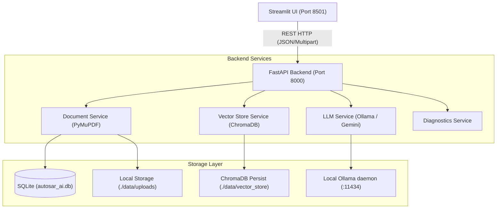

# ARCHITECTURE AUDIT: CURRENT PLATFORM TECHNICAL DESIGN

## 1. System Topology Overview
The **AUTOSAR AI** platform is implemented as a decoupled, multi-tier client-server application engineered for high-assurance document analysis in automotive engineering contexts.

---

## 2. Component-by-Component Architectural Audit

### 2.1 Frontend Tier (`frontend/`)
- **Technology Stack**: Streamlit 1.x with custom CSS design system (`frontend/utils/ui.py`).
- **Pages**:
  - `app.py`: Entry point and navigation dispatch.
  - `1_Dashboard.py`: Live metrics, recent document activity, and system subsystem status.
  - `2_Documents.py`: Specification PDF upload, document list, reprocessing, and deletion.
  - `3_Architecture_Explorer.py`: Extracted component/runnable/interface explorer with interactive review status.
  - `4_AI_Assistant.py`: Multi-turn conversational interface with source citations.
  - `5_Comparisons.py`: Baseline vs comparison revision diff and historical comparison runs.
  - `6_Findings.py`: Enterprise rule validation review dashboard.
  - `7_Reports.py`: Multi-format report generation (CSV, JSON, PDF) with download management.
  - `8_Settings.py`: Runtime configuration sliders for chunk size, overlap, OCR, and enterprise rules.
- **Architectural Findings**:
  - Direct HTTP calls to FastAPI backend using `requests`.
  - State maintained via Streamlit `st.session_state`.
  - Native `st.container(border=True)` cards used for responsive presentation.

### 2.2 Backend API Tier (`backend/api/v1/`)
- **Technology Stack**: FastAPI, Pydantic V2, Uvicorn ASGI server.
- **Routers**:
  - `projects.py`: Project lifecycle and membership.
  - `documents.py`: File upload, SHA-256 deduplication, async processing, reprocess, delete.
  - `entities.py`: Architectural entity querying, updates, and review workflows (`confirmed`, `rejected`, `pending`).
  - `sessions.py`: Q&A query processing, vector context retrieval, citations assembly, and chat history.
  - `comparisons.py`: Multi-document structural entity comparison.
  - `findings.py`: Architectural rule violations and remediation status updates.
  - `reports.py`: Generation of sanitized CSV, JSON, and text/PDF reports.
  - `diagnostics.py`: End-to-end subsystem latency and reachability testing.
  - `settings.py`: Runtime configuration read/update endpoint.

### 2.3 Document Processing & Extraction (`backend/services/document_service.py`)
- **PDF Parser**: `PyMuPDF` (`pymupdf.open`) extracts plain text and preserves exact page indices.
- **Chunking Algorithm**:
  - Character-based sliding window with overlap (`chunk_size=1000`, `overlap=150`).
  - Each chunk calculates a SHA-256 content hash and records `page_start` and `page_end`.
- **Entity Extraction**:
  - Regular expression heuristic patterns detecting:
    - Software Components (`_SWC`, `Component`, `Controller`, `Manager`, `Actuator`, etc.) — Confidence: 0.92
    - Runnables (`Runnable_`, `run_`, `_Runnable`) — Confidence: 0.90
    - Interfaces (`_IF`, `_Interface`, `SenderReceiver_`, `ClientServer_`) — Confidence: 0.88
- **Enterprise Safety Rules**:
  - Regex checks for Insecure IPC (shared memory, unauthenticated CAN).
  - Regex checks for Unbounded Arrays (MISRA C Rule 17.2).
  - Graph coupling analysis detecting circular dependencies between SWC entities.

### 2.4 Vector Store & Embedding Tier (`backend/services/vector_store_service.py`)
- **Engine**: ChromaDB `PersistentClient` targeting `./data/vector_store`.
- **Collections**: Partitioned per project (`project_{project_id}`).
- **Embedding Generation**: Default ChromaDB embedding model / SentenceTransformers (`all-MiniLM-L6-v2`).
- **Metadata Preserved in Vector Index**:
  - `document_id` (integer)
  - `chunk_index` (integer)
  - `page_start` (integer)
  - `page_end` (integer)
- **Filtering**: Supports document-scoped vector search via ChromaDB metadata filter (`where={"document_id": ...}`).

### 2.5 LLM Integration Tier (`backend/services/llm_service.py`)
- **Configured Providers**:
  - **Local Ollama** (`http://localhost:11434`, model: `llama3.2:3b`, storage: `H:\OllamaModels`): Verified active, responsive, and generating grounded responses in ~2-4s.
  - **Google Gemini** (`gemini-1.5-pro-latest`): Configured as optional cloud fallback when `LLM_API_KEY` is provided.
- **Grounded Prompting**: Strict system prompt enforcing zero hallucinations, document-only evidence, and explicit abstention.
- **Fail-Safe Mechanism**: No silent fallback between providers; explicit error messages when local Ollama is offline or timed out.

### 2.6 Relational Database Tier (`backend/models/domain.py`)
- **Engine**: SQLite via SQLAlchemy ORM.
- **Database File**: `./data/autosar_ai.db`.
- **Schema Inventory (10 Tables)**:
  1. `users`: Authentication and roles.
  2. `projects`: Project workspaces.
  3. `project_memberships`: Role-based access control.
  4. `documents`: Ingested PDF metadata, storage paths, SHA-256 hashes, status.
  5. `document_chunks`: Extracted text chunks, page offsets, content hashes.
  6. `architecture_entities`: Extracted SWCs, Runnables, Interfaces, confidence, review status.
  7. `architecture_relationships`: Entity-to-entity dependency edges.
  8. `analysis_sessions`: Q&A chat sessions.
  9. `analysis_messages`: Chat query/response messages with serialized citations JSON.
  10. `findings`: Architectural rule violations, severity, and reviewer notes.
  11. `document_comparisons`: Baseline vs comparison revision diff records.
  12. `reports`: Exported report artifacts on disk.
  13. `audit_logs`: System audit trail records.

---

## 3. Verified Facts vs Assumptions

| Aspect | Verified Fact | Unverified / Known Limitation |
| :--- | :--- | :--- |
| **Local LLM Execution** | Ollama `llama3.2:3b` generates real tokens from ChromaDB context chunks | Gemini API is untested in this environment due to missing cloud API key |
| **Document Parsing** | PyMuPDF extracts text and exact page numbers accurately from standard PDFs | Scanned PDFs requiring Tesseract OCR have not been tested with raster images |
| **Data Persistence** | Uploads, chunks, entities, findings, comparisons, and chat sessions persist across restarts | Distributed multi-user locking has not been tested (SQLite single-writer limitation) |
| **Entity Extraction** | Regex heuristics extract AUTOSAR naming conventions with high precision | Deep nested XML / ARXML structure is not yet parsed directly |
