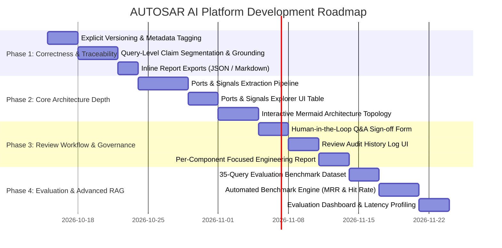

# IMPLEMENTATION ROADMAP: AUTOSAR HLD INTELLIGENCE PLATFORM

This roadmap outlines a prioritized, phased engineering plan to bring our application to full functional superiority over the reference baseline without breaking any existing verified features.

---

## 1. Overview of Phases

---

## 2. Phase 1: Correctness & Traceability (High Value / Low-to-Medium Risk)
**Goal**: Complete claim-level traceability, explicit version tagging, and immediate export capabilities.

1. **Task 1.1 — Explicit Specification Versioning on Upload**:
   - Expose `version_label` (e.g. `1.0`, `2.0`) and `governance_state` (`DRAFT`, `APPROVED`) in `frontend/pages/2_Documents.py`.
   - Propagate version tags into `document_chunks` and ChromaDB vector metadata.
   - *Effort*: 1 day | *Risk*: Low
2. **Task 1.2 — Claim Segmentation & Grounding Score Metric**:
   - Update `backend/services/llm_service.py` to segment answers into distinct claims.
   - Calculate lexical grounding percentage against retrieved chunks.
   - Display metric cards (`CONFIDENCE`, `GROUNDING SCORE: 100%`) and claim badges (`[Grounded]`).
   - *Effort*: 2 days | *Risk*: Low
3. **Task 1.3 — Inline Q&A Report Downloads (Markdown & JSON)**:
   - Add `Download Markdown Report` and `Download JSON Report` buttons directly inside `frontend/pages/4_AI_Assistant.py`.
   - Ensure exported Markdown matches the reference format seen in `WhatsApp Image 2026-10-12 at 8.07.53 PM.jpeg`.
   - *Effort*: 1 day | *Risk*: Low

---

## 3. Phase 2: Core Architecture Depth (Ports, Signals & Graphs)
**Goal**: Elevate architectural extraction to match the reference project's port-signal precision and visual graph representation.

1. **Task 2.1 — Ports & Signals Extraction Engine**:
   - Enhance regex and AST extraction in `backend/services/document_service.py` to identify:
     - Ports (`DiagnosticRequestIn`, `SafetyStatusOut`, `VehicleSpeedOut`, etc.)
     - Directions (`Input`, `Output`, `Bidirectional`)
     - Associated Interfaces (`DiagnosticInterface`, `VehicleDataInterface`)
     - Carried Signals (`VehicleSpeed`, `EngineRPM`, `SafetyStatus`)
   - Store in `models.ArchitectureEntity` with `entity_type="Port"` and `entity_type="Signal"`.
   - *Effort*: 3 days | *Risk*: Medium
2. **Task 2.2 — Ports & Signals Explorer Table**:
   - Add dedicated sub-tab in `frontend/pages/3_Architecture_Explorer.py` displaying Port Definitions table.
   - Filterable by Specification Version (`1.0`, `2.0 (Latest)`).
   - *Effort*: 2 days | *Risk*: Low
3. **Task 2.3 — Interactive Mermaid Architecture Topology Diagram**:
   - Automatically generate Mermaid diagram code connecting SWCs and Interfaces via `DEPENDS_ON`, `REQUIRES`, and `PROVIDES` edges.
   - Render in `3_Architecture_Explorer.py` alongside the `Directed Graph Edges` table.
   - *Effort*: 2 days | *Risk*: Low

---

## 4. Phase 3: Engineering Review & Audit Governance
**Goal**: Implement comprehensive human-in-the-loop review trails for ISO 26262 sign-off compliance.

1. **Task 3.1 — Query-Level Engineering Sign-Off Form**:
   - Add an inline sign-off card below assistant responses:
     - Review Decision (`Accepted`, `Rejected`, `Needs Modification`)
     - Reviewer ID / Signature (e.g. `automotive_engineer_1`)
     - Engineering Feedback / Audit Notes
     - Corrected Architecture Facts
   - Persist to `analysis_messages` and `audit_logs` tables.
   - *Effort*: 2 days | *Risk*: Low
2. **Task 3.2 — Review Audit History Log UI**:
   - Create a dedicated view displaying all recorded review events with filters.
   - Columns: `ID`, `Question`, `Decision`, `Engineer ID`, `Feedback`, `Corrections`, `Timestamp`.
   - *Effort*: 1.5 days | *Risk*: Low
3. **Task 3.3 — Per-Component Engineering Report Generator**:
   - In `frontend/pages/7_Reports.py`, allow selecting a specific Software Component and Version.
   - Generates a deep component brief covering ports, interfaces, runnables, and review history.
   - *Effort*: 2 days | *Risk*: Low

---

## 5. Phase 4: Quantitative Evaluation & Advanced Retrieval
**Goal**: Equip the platform with offline RAG quality validation and hybrid search.

1. **Task 4.1 — 35-Query Evaluation Benchmark Dataset**:
   - Curate 25 technical architectural queries and 10 adversarial out-of-scope prompts with ground-truth chunk citations.
   - Save to `data/evaluation/benchmark_dataset.json`.
   - *Effort*: 2 days | *Risk*: Low
2. **Task 4.2 — Automated Benchmark Engine & Metrics Calculator**:
   - Implement `backend/services/evaluation_service.py` computing:
     - Retrieval MRR
     - Hit Rate @ 1
     - Citation Precision
     - Supported Claims %
     - Abstention Accuracy
     - Component latencies (Embedding, Search, LLM inference, End-to-End)
   - Expose via `POST /api/v1/evaluation/run`.
   - *Effort*: 3 days | *Risk*: Medium
3. **Task 4.3 — Evaluation Dashboard UI**:
   - Add an `Engineering Evaluation` page displaying performance summaries and latency profiles.
   - *Effort*: 2 days | *Risk*: Low
4. **Task 4.4 — Hybrid BM25 + Dense RRF Search (Optional Advanced)**:
   - Implement BM25 ranker over text chunks and combine with ChromaDB dense scores via Reciprocal Rank Fusion.
   - *Effort*: 3 days | *Risk*: Medium

---

## 6. Execution Rules
- **No Regressions**: All 16 existing unit tests must remain passing at all times.
- **Maintain Decoupling**: Business logic resides strictly in `backend/`; `frontend/` handles rendering and user interaction only.
- **Preserve Local LLM Autonomy**: The application must remain 100% capable of offline operation using local Ollama (`llama3.2:3b`).
